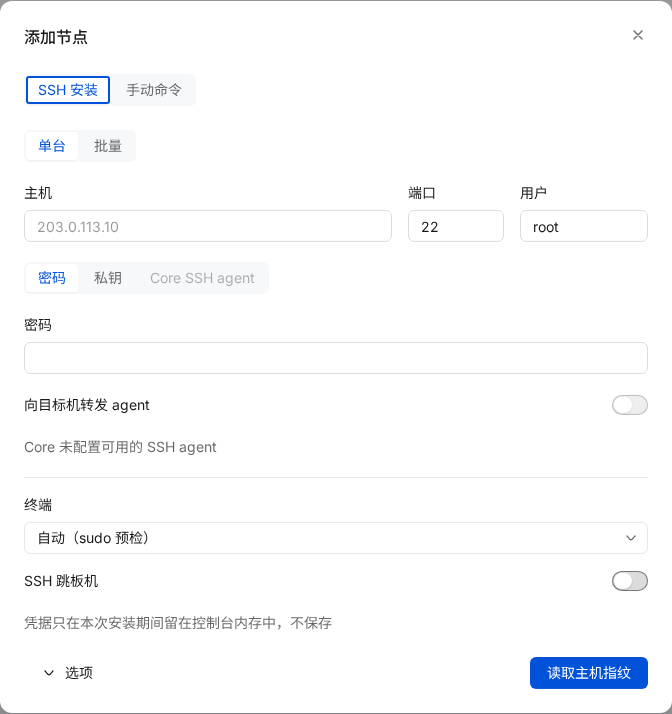
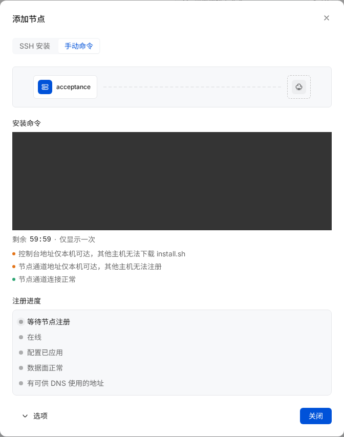

# 接入节点

经 SSH 由控制台安装，或在 Linux 主机、容器中安装边缘节点并注册到集群：要求、发布物与校验、安装命令、SSH 安装、手动安装、注册与 mTLS、退役、端口、访客 IP、区域探针与下载镜像。





组件、端口与文件总表见 [节点概览](../node/README.md)。

## 要求

| 项目 | 要求 |
| --- | --- |
| 系统 | Linux，amd64 或 arm64，glibc 2.34 及以上：RHEL、Rocky、AlmaLinux 9 及以上，Debian 12 及以上，Ubuntu 22.04 及以上；systemd（`--no-start` 与容器不要求） |
| 权限 | root 或 sudo |
| 命令 | `curl`、`sha256sum`、`tar`；`openssl`（可选，用于安装前核对节点通道的 CA） |
| 访问控制台 | `EDGEWEIR_PUBLIC_URL`（`/install.sh`、`/downloads/*`）与节点通道地址（**系统设置** 的「节点通道」，默认 8443），见 [端口与反向代理](networking.md) |
| 访问外部 | `github.com` 与 `api.github.com`（未使用 `--mirror-only` 时） |
| 端口 | 80、443 等未被其他程序占用，见 [端口与防火墙](#端口与防火墙) |

## 发布物

发布在 [GitHub Releases](https://github.com/marvinli001/edgeweir-node/releases)，`<版本>` 为不带 `v` 的版本号。

| 文件 | 内容 |
| --- | --- |
| `edgeweir-node_<版本>_amd64.deb`、`_arm64.deb` | agent、Lua 模块、systemd 单元、`/etc/default/edgeweir-node`；依赖 `edgeweir-openresty (>= 1.31.1.1-3)`，推荐 `edgeweir-openresty-modsecurity` 与 `nftables` |
| `edgeweir-node-<版本>-1.x86_64.rpm`、`.aarch64.rpm` | 同上 |
| `edgeweir-node_<版本>_linux_amd64.tar.gz`、`_linux_arm64.tar.gz` | 目录 `edgeweir-node_<版本>_linux_<架构>/`：`edgeweir-node`、`lua/edgeweir/`、`systemd/edgeweir-node.service`、`systemd/edgeweir-probe.service`、`LICENSE`、`NOTICE` |
| `edgeweir-openresty_1.31.1.1-3_<架构>.deb`、`edgeweir-openresty-1.31.1.1-3.<架构>.rpm` | OpenResty，`/usr/lib/edgeweir-openresty/`；只有 deb 与 rpm |
| `edgeweir-openresty-modsecurity_1.31.1.1-3_<架构>.deb`、`.rpm` | ModSecurity 模块与 OWASP CRS 4.29.0；不安装时该节点不支持 [OWASP CRS](../guide/waf.md) |
| `*.sbom.json` | 每个压缩包、安装包与 edgeweir-openresty 的 SBOM（SPDX） |
| `checksums.txt`、`checksums.txt.sigstore.json` | 全部文件的 SHA-256 与 cosign 无密钥签名 |
| 镜像 `ghcr.io/marvinli001/edgeweir-node:<版本>` | amd64、arm64；另有 `X.Y` 与 `latest` 标签；cosign 签名与构建来源证明 |

不再使用 openresty.org 的软件源；早先由 `install.sh` 添加的 openresty.org 软件源与 `openresty` 软件包可以删除。

### 校验发布物

`install.sh` 自动执行签名与 SHA-256 校验。手动安装前执行：

```bash title="下载目录"
cosign verify-blob \
  --bundle checksums.txt.sigstore.json \
  --certificate-identity "https://github.com/marvinli001/edgeweir-node/.github/workflows/release.yml@refs/tags/v<版本>" \
  --certificate-oidc-issuer https://token.actions.githubusercontent.com \
  checksums.txt
sha256sum --ignore-missing -c checksums.txt
gh attestation verify edgeweir-node_<版本>_linux_amd64.tar.gz --repo marvinli001/edgeweir-node
```

| 步骤 | 预期 |
| --- | --- |
| `cosign verify-blob` | `Verified OK` |
| `sha256sum` | 每个已下载的文件为 `OK` |
| `gh attestation verify` | 构建来源证明属于 `marvinli001/edgeweir-node` 的发布工作流；镜像用 `gh attestation verify oci://ghcr.io/marvinli001/edgeweir-node:<版本> --repo marvinli001/edgeweir-node` |

发布物由 GitHub Actions 从 tag 构建，可复现（`-trimpath`，时间戳取提交时间）。

## 1. 生成安装命令

1. 打开 **集群与节点**，选择集群，点击 **添加节点**，切换到 **手动命令**（默认页签是 [SSH 安装](#ssh-安装)）。对话框立即显示 **安装命令**：集群的默认节点组，有效期 1 小时，不带节点名称。
2. 需要节点名称、其他节点组或有效期时，打开 **选项**：填写 **节点名称**，选择 **节点组**（集群有多个节点组时显示）与 **有效期**（15 分钟、1 小时、24 小时），点击 **重新生成**。
3. 复制 **安装命令**。命令下方显示剩余时间、「仅显示一次」、地址提醒与 [节点通道连接检查](#节点通道连接检查)；关闭对话框后不再显示，再次打开生成新的 token。
4. 在节点上执行命令后，对话框的 **注册进度** 每 3 秒刷新：等待节点注册（或令牌已过期）、已注册（节点名称链接到节点详情）、在线、配置已应用、数据面正常、有可供 DNS 使用的地址。
5. 查询失败时显示错误与 **重试**，已获取的进度会保留；节点通道检查的请求失败单独显示，不表示节点尚未注册。五步完成后，可点击 **新建网站** 打开创建表单。

| 项目 | 行为 |
| --- | --- |
| 注册 token | `ewt_` 前缀，单次有效，数据库只存 SHA-256；生成操作写入审计日志 |
| `--server` | **系统设置** 中的「节点通道」地址，见 [节点通道地址与证书](networking.md#节点通道地址与证书) |
| `--ca-sha256` | 节点通道内部 CA 的 SHA-256 指纹，与 **系统设置** 中的「CA 指纹」相同 |
| API | `POST /api/v1/enrollment-tokens`，`ttlMinutes` 取值 5–10080，默认 60；`GET /api/v1/enrollment-tokens/{id}` 返回 `usedAt` 与注册的节点。见 [API 与端点](../reference/api.md) |
| 地址提醒 | 控制台地址（`install.sh` 从此下载）或节点通道地址是 localhost、回环或内网地址时，对话框逐条提醒，**系统设置** 中的地址旁显示「仅本机可达」或「内网地址」；控制台地址是公网 HTTP 地址时提醒「控制台地址未加密，install.sh 将以明文传输」，**系统设置** 中标「未加密」。控制台启动时为每条提醒写一条警告日志；不阻止生成 |
| 清理 | 过期或使用超过 7 天的 token 每 30 分钟删除一次 |

### 节点通道连接检查

控制台用节点通道地址与自己的节点通道做一次 TLS 握手（不带客户端证书，不发送请求），比较对方出示的证书链与节点通道内部 CA；`wss://`、`ws://` 地址先在 `/node-channel` 完成 WebSocket 握手，再在其中做这次 TLS 握手。结果在 **系统设置** 的「节点通道」卡片中显示在地址下方；在添加节点对话框中显示为一行，检查未通过时带「修改」链接，打开 **系统设置**。

| 结果（系统设置 / 添加节点对话框） | 含义 |
| --- | --- |
| 连接正常 / 节点通道连接正常 | 握手成功，证书链含节点通道内部 CA |
| 控制台无法连接该地址 / 控制台无法连接节点通道地址 | 3 秒内没有完成握手：地址或解析错误，端口未放行，或控制台所在网络到不了该地址 |
| 证书不符，前面可能有代理或 CDN / 节点通道证书不符，前面可能有代理或 CDN | 出示了其他证书链：代理或 CDN 终结了 TLS，或地址指向其他服务，节点 mTLS 会失败，见 [节点通道四层透传](networking.md#节点通道四层透传)；`wss://`、`ws://` 地址的 WebSocket 握手被拒绝（入口未开放或地址指向其他服务）也是此结果，见 [节点通道的 WebSocket 入口](networking.md#节点通道的-websocket-入口) |
| 出站策略不允许连接该地址 / 出站策略不允许连接节点通道地址 | **系统设置** 中保存的地址解析到内网、回环等特殊用途地址，`EDGEWEIR_OUTBOUND_ALLOW_CIDRS` 未放行：控制台不连接。`EDGEWEIR_NODE_API_URL` 与默认地址不受此限制 |

结果为无法连接或证书不符时，控制台再检查 [WebSocket 入口](networking.md#节点通道的-websocket-入口)：`wss://<EDGEWEIR_PUBLIC_URL 的主机[:端口]>`（控制台地址为 `http://` 时是 `ws://`），以及 `https://` 节点通道地址自己的主机 443 端口。入口关闭时也能检查：检查请求带控制台签发的一次性令牌，入口只为这次检查转发，不对其他请求开放。

| 候选结果 | 显示 |
| --- | --- |
| 通过（经代理或 CDN 在 WebSocket 内看到节点通道内部 CA） | 「WebSocket 入口 `wss://…` 可用」与 **改用**。点击即把该地址保存为节点通道地址（覆盖 `EDGEWEIR_NODE_API_URL`）、开放入口并写审计日志；已注册的节点与探针检查新地址后自动切换（[更换节点通道地址](networking.md#更换节点通道地址)）。在添加节点对话框中点击，会用同样的选项重新生成安装命令 |
| 未通过 | 原提示下加一行：改为四层透传节点通道端口，或关闭该域名的 CDN 代理（如 Cloudflare 灰云），见 [节点通道四层透传](networking.md#节点通道四层透传) |

检查只作提示，不阻止任何操作：控制台能连上自己的地址，不代表其他网络的节点也能连上；控制台所在网络不支持访问自己的公网地址（NAT 回流）时，结果为无法连接，节点仍可能正常注册。结果缓存 30 秒，地址改变后重新检查。API：`GET /api/v1/settings/node-channel-check`，返回 `{ url, result, candidate, checkedAt }`，`result` 为 `ok`、`unreachable`、`mismatch` 或 `refused`；`candidate` 为 `{ url, result }`，没有检查候选时为 `null`。

## 2. 执行安装命令

在节点主机（不是控制台主机）上以具备 sudo 权限的账户执行生成的命令：

```bash title="节点"
sh <<'EDGEWEIR_INSTALL'
set -eu
unset EDGEWEIR_TOKEN
umask 077
d=
trap '[ -z "$d" ] || rm -rf "$d"' EXIT
trap 'exit 130' INT
trap 'exit 143' TERM
d=$(mktemp -d "${TMPDIR:-/tmp}/edgeweir-install.XXXXXXXX")
chmod 0700 "$d"
cat >"$d/token" <<'EDGEWEIR_ENROLLMENT_TOKEN'
<one-time-token>
EDGEWEIR_ENROLLMENT_TOKEN
chmod 0600 "$d/token"
curl -fsSL https://cdn-admin.example.com/install.sh -o "$d/install.sh"
set -- --token-file "$d/token" --server https://cdn-admin.example.com:8443 --ca-sha256 <ca-sha256>
if [ "$(id -u)" = 0 ]; then
  bash "$d/install.sh" "$@" </dev/null
else
  sudo bash "$d/install.sh" "$@" </dev/null
fi
EDGEWEIR_INSTALL
```

完整复制生成的命令，包括起止标记。命令通过 stdin 写入 0700 临时目录中的 0600 令牌文件，再以 `--token-file` 交给安装器；sudo 只接收文件路径。成功、下载或安装失败、INT/TERM 中断后自动清理。安装器到 enroll 也只使用私密文件，不删除用户提供的文件。旧的 `EDGEWEIR_TOKEN` 输入仍兼容，但不会传给子进程；`--token` 被拒绝。

其他选项加在脚本中 `set -- --token-file …` 这一行的末尾，例如 `--force` 或 `--version 1.7.0`。

| 选项 | 默认值 | 作用 |
| --- | --- | --- |
| `--server URL` | 必需 | 节点通道地址：`https://`，或 WebSocket 入口 `wss://`、`ws://`（节点 0.2.0 及以上） |
| `--ca-sha256 HEX` | 必需 | 内部 CA 的 SHA-256，64 位小写十六进制 |
| `--token-file PATH` | 无 | 从文件读取 token，优先于 `EDGEWEIR_TOKEN` |
| `--version VER` | `latest` | 安装的版本，可带 `v`；`latest` 依次取镜像的 `latest` 文件与 GitHub 最新发布 |
| `--format auto\|deb\|rpm\|tar` | `auto` | 有 `dpkg` 与 `apt-get` 用 deb，有 `rpm` 与 `dnf`/`yum` 用 rpm，否则 tar |
| `--mirror URL` | `<EDGEWEIR_PUBLIC_URL>/downloads/edgeweir-node` | 发布镜像，见 [下载镜像](#下载镜像) |
| `--mirror-only` | 关 | 不回退到 GitHub |
| `--no-modsecurity` | 关 | 不安装 `edgeweir-openresty-modsecurity` |
| `--no-start` | 关 | 只安装与注册：不要求 systemd，不启动服务，不做健康检查 |
| `--force` | 关 | 已注册的主机以新 token 重新注册 |
| `--allow-unsigned` | 关 | 跳过 cosign 签名校验，仅用于开发；仍校验 SHA-256 |

退出码：`0` 完成，`1` 任一步骤失败（stderr 为 `[edgeweir] error: <原因>`），`2` 缺少必需选项或 `--help`。另见 [命令行](../reference/cli.md#节点安装脚本)。

## 3. 验证

`install.sh` 最后等待 `edgeweir-node healthcheck` 通过（[install.sh 流程](#installsh-流程) 第 11 步），输出 `done: edgeweir-node is healthy (revision N, M sites)`。之后：

```bash title="节点"
systemctl status edgeweir-node
sudo edgeweir-node diagnose
```

预期：`edgeweir-node.service` 为 `active (running)`；`diagnose` 每项为 `ok`；**集群与节点** 中该节点状态为「在线」，**已应用版本** 显示配置版本号。节点注册后、首次连接节点通道前状态为「等待心跳」；在线但尚未应用配置时 **已应用版本** 标「待应用配置」。

## SSH 安装

控制台通过一次性 SSH 连接运行同一个签名安装器；后续管理仍走节点通道。

1. 在 **集群与节点 → 添加节点 → SSH 安装** 填写主机、端口（22）、用户（root）。批量每行 `主机[:端口] [用户] [节点名称]`，IPv6 用 `[地址]:端口`；也支持 CSV `主机,端口,用户,节点名称`、表头、空行和 `#` 注释。每次最多 200 台，共用一份目标凭据，行内用户优先。
2. 选择密码、私钥（OpenSSH/PEM/PPK，可带口令）或 **Core SSH agent**。非 root 用户可填 sudo 密码；不填时使用免密 sudo。**终端** 默认 **自动（sudo 预检）**：只在安装前预检发现 requiretty 时启用 PTY。也可选始终使用或不使用 TTY；进入安装阶段后不会因 TTY 错误自动重跑。
3. 需要跳板机时启用 **SSH 跳板机**，填写独立的地址、端口、用户和认证。先扫描它的指纹，与可信渠道提供的 `ssh-keygen -lf /etc/ssh/ssh_host_ed25519_key.pub` 核对，勾选 **已核对跳板机指纹**。跳板机密钥未确认时不登录它。
4. 点击 **读取主机指纹**，逐台核对目标机的 `SHA256:…`。目标机扫描只取密钥；通过跳板时仅登录已确认的跳板机。两跳分别校验密钥，本跳不匹配时不发送本跳登录凭据。
5. 设置节点组、版本、包格式、下载镜像、ModSecurity、并发（默认 5，最大 20）和单台超时（默认 15 分钟，1–60），点击 **安装 N 台**。页面显示两跳连接、认证、sudo 预检、下载安装器、安装步骤及结果；点击主机查看脱敏输出。
6. 可请求停止或重试失败主机。重试重新发送目标及跳板凭据，并使用相同跳板路径和确认的指纹；跳板密钥变化时先重新扫描核对。关闭对话框后凭据丢失。复制结果包含节点 id、取消请求和清理状态。

### Agent 与网络

管理员在 **Core 服务器运行环境** 显式设置 `EDGEWEIR_SSH_AGENT_SOCKET`，指向已有、已加载密钥的 Unix agent socket。它必须可由 Core 用户访问，由该用户或 root 所有，且组/其他用户不可写。容器部署需挂载服务器 socket 并匹配 Core 的 UID/权限；不能把操作者电脑的 `SSH_AUTH_SOCK` 从浏览器传入。未配置、无密钥、权限错误或不可访问时，API 和界面显示不可用，不返回 socket 路径。

Agent 登录与 **向目标机转发 agent** 独立，转发默认关闭；密码/私钥登录也可显式转发。跳板机仅承载 TCP 隧道，不向跳板机转发 agent；其登录仍可独立使用 agent。取消和超时立即关闭原连接及转发；清理另建不转发 agent 的连接。sudo 环境策略仍可能移除 root 进程的 `SSH_AUTH_SOCK`。私钥不从 agent 导出。

两跳和目标均由 Core 解析 DNS、执行 `EDGEWEIR_OUTBOUND_ALLOW_CIDRS` 策略，再按检查过的 IP 连接；`forwardOut` 也只接收该 IP，跳板机不重新解析。仅跳板机能解析的名字不支持，应提供 Core 可解析的名字或允许的 IP。Core 要能到达第一跳；目标机要能访问控制台、节点通道与软件包源。

### 停止与恢复

`cancelRequested` 表示已请求取消。排队主机不再启动；运行主机显示清理结果：

| cleanup | 含义 |
| --- | --- |
| `not_needed` | 尚未启动远端安装任务 |
| `pending` | 正在停止或确认 |
| `stopped` | 已确认本次进程停止，令牌、脚本和临时目录已清理 |
| `unknown` | 无法确认远端状态；关闭 SSH 不等于清理完成 |

安装器在独立进程组内运行，远端期限不依赖 SSH 连接。终止先发送 TERM，给予有限宽限后必要时 KILL；只处理本次任务的进程与目录，保留节点身份及现有 CDN 服务。未使用的注册令牌及时作废。注册后失败、取消或失联仍保留 `nodeId` 和完成步骤；使用过令牌不等于整次安装成功。

软件包安装可能中断，不保证回滚系统。重试前检查 `dpkg --audit`/`dpkg --configure -a` 或对应 RPM/DNF 状态，按包管理器提示恢复。控制台重启会丢失内存中的任务，应核对节点列表；远端期限仍生效。

密码、私钥、口令、sudo 密码只在必要请求和运行内存中存在，不进入数据库、日志、审计、队列、导出或浏览器存储。令牌通过 0700 临时目录里的 0600 文件交给 `--token-file`，不进参数或环境；PTY 在成功关闭回显和终端输入处理、回传就绪标记后才收秘密。安装器 stdin 固定为 `/dev/null`，不会读到遗留 sudo 密码。每台保留最多 64 行/16 KiB 脱敏输出，结果行单独解析。

### API

路径前缀 `/api/v1`；写操作限运营者写权限 AccessKey，服务账号不可调用。能力和状态可用只读 AccessKey 查询。

| 请求 | 说明 |
| --- | --- |
| `GET /ssh-installs/capabilities` | `{version:2,agent:{available,reason}}`；reason 为 `not_configured`、`unavailable` 或 null |
| `POST /ssh-installs/host-keys` | `{hosts:[{host,port}],jumpHost?}`；每台返回算法、指纹、error、errorHop、presentedFingerprint |
| `POST /ssh-installs` | 既有 clusterId/nodeGroupId/hosts/options/concurrency/timeoutMinutes，增加 `tty`、`jumpHost`；目标 `credential` 增加独立的 `agent`、`agentForwarding`（默认 false） |
| `GET /ssh-installs/{id}` | 任务、主机状态、phase、step、completedSteps、exitCode、nodeId、cancelRequested、cleanup、errorHop 和脱敏 output；过期或重启后 404 `SSH_INSTALL_NOT_FOUND` |
| `POST /ssh-installs/{id}/cancel` | 请求取消，继续轮询清理结果 |
| `POST /ssh-installs/{id}/retry` | `{credential,tty,jumpHost?,hosts?:[{id,hostKeyFingerprint?}]}`；任务仍在运行时 409 `SSH_INSTALL_BUSY` |

`tty` 为 `auto|always|never`。`jumpHost` 为 `{host,port,hostKeyFingerprint,credential}`，它的 credential 含独立 username 和认证；重试跳板机时必须重新提供。错误包括 `sudo_password_wrong`、`sudo_not_allowed`、`sudo_requires_tty`（显式禁用 TTY）、`pty_refused`（服务器拒绝或无法关闭回显）、`agent_unavailable`、`host_key_mismatch`、`outbound_refused`，以及安装器已有的分步错误。`errorHop` 区分 jump/target。

任务结束保留 1 小时，同时最多 4 个运行。扫描、开始、重试均不接受 `Idempotency-Key`，不保留凭据请求体的哈希。审计保留主机、指纹、结果、节点 id、取消和清理状态，不保留秘密。

## install.sh 流程

| 步骤 | 行为 | 失败时 |
| --- | --- | --- |
| 1 | 读取 token（`EDGEWEIR_TOKEN` 或 `--token-file`），校验 `ewt_` 格式，从环境中移除，子进程不继承。状态目录已有 `identity.json`（已注册）时不需要 token，给出也不使用；加 `--force` 时仍需要 token | 退出 |
| 2 | 检查 Linux、root、`curl`、`sha256sum`、`tar`、systemd、架构，选择安装格式。未注册时再检查节点通道：`--server` 须有 HTTP 响应（任意状态码，不发送 token）；主机有 `openssl` 时，服务器出示的最后一张证书须为 `--ca-sha256` 固定的 CA。`wss://`、`ws://` 地址改为请求 `https://`（`ws://` 为 `http://`）`<主机[:端口]>/node-channel`，须返回 426（入口开放）；CA 在第 9 步注册时于 WebSocket 内核对 | 退出，指出无法连接、前面有终结 TLS 的代理，或 WebSocket 入口未开放 |
| 3 | 解析版本：`--version`，或下载镜像的 `latest` 文件，再回退到 GitHub 最新发布。已注册的主机未给 `--version` 与 `--force` 时跳过第 3–9 步，不下载、不安装。经 `wss://`、`ws://` 地址注册时版本须为 0.2.0 及以上 | 退出，提示传入 `--version` |
| 4 | 下载 `checksums.txt` 与 `checksums.txt.sigstore.json`：先下载镜像，后 GitHub | 退出 |
| 5 | `cosign verify-blob` 校验签名：证书身份必须为 `https://github.com/marvinli001/edgeweir-node/.github/workflows/release.yml@refs/tags/v<版本>`，签发者 `https://token.actions.githubusercontent.com`。主机无 cosign 时下载 cosign v3.1.3，核对脚本内固定的 SHA-256 后安装到 `/usr/local/bin/cosign` | 退出 |
| 6 | 从已签名的 `checksums.txt` 选出本机的安装包，以及同一发布的 `edgeweir-openresty`、`edgeweir-openresty-modsecurity`（每个软件包、格式、架构恰好一个文件）；glibc 低于 2.34 时退出；下载（先镜像，后 GitHub）并校验 SHA-256 | 退出 |
| 7 | 先安装 `edgeweir-openresty` 与 `edgeweir-openresty-modsecurity`。tar.gz 安装时按主机的 `dpkg` 或 `rpm` 选择格式；两者都没有时要求已安装 `edgeweir-openresty` | 退出 |
| 8 | 安装 deb（`apt-get install`，无 apt-get 时 `dpkg -i`）、rpm（`dnf`、`yum` 或 `rpm -Uvh`）或 tar.gz | 退出 |
| 9 | `edgeweir-node enroll`：核对 CA 指纹后提交 token，本机生成私钥，以 CSR 换取节点证书；此后仅经 mTLS 通信。已注册时跳过；加 `--force` 时先停止 `edgeweir-node.service`，以新 token 执行 `edgeweir-node enroll --force` 替换身份，第 10 步再启动 | 退出 |
| 10 | 停用 `openresty.service`，启用并启动 `edgeweir-node.service`（`--no-start` 时跳过第 10、11 步）；tar.gz 安装与跳过安装的重新运行先重启运行中的服务（deb、rpm 由包脚本重启） | 退出 |
| 11 | 每 3 秒执行一次 `edgeweir-node healthcheck`，最多 90 秒，直到数据面已应用配置；通过时输出 `done: edgeweir-node is healthy (revision N, M sites)` | 退出码 28，提示 `journalctl -u edgeweir-node -n 50` |

- 第 5、6 步通过前不执行任何下载的程序。
- 脚本全部由函数组成，最后一行才调用 `main`：下载中断时不执行任何内容。
- 已注册的主机可以重新运行同一命令：不下载、不重装，启动服务（运行中则重启）并做健康检查；加 `--version <版本>` 时先安装该版本。主机上没有 `/usr/bin/edgeweir-node` 时安装最新版本。edgeweir-node 1.7.0 起先执行 `edgeweir-node enroll --if-not-enrolled` 核对身份：属于本控制台时报告原来的节点，属于另一个控制台时以退出码 26 失败，不重启服务。
- 控制台不保存 SSH 凭据（[SSH 安装](#ssh-安装) 只在该次安装期间用于内存中）；节点私钥不离开节点。

### 结果行与退出码

`install.sh` 的说明文字在 stderr；stdout 每步一行 `EDGEWEIR_RESULT {"v":1,"step":"…","status":"…"}`（JSON 在同一行，未知字段忽略），供 SSH 安装等自动化读取。步骤为 `args`、`check`、`download`、`verify`、`install`、`enroll`、`start`、`health`；`status` 为 `ok`、`skipped` 或 `failed`（失败行带英文 `message`），注册一步由 edgeweir-node 1.7.0 起自己写（`enrolled`、`already_enrolled`、`token_rejected`、`enrolled_elsewhere` …，带 `node_id`）。最后一行为 `{"step":"done","status":"ok|failed","failed_step":"…","exit":N}`。

| 退出码 | 含义 |
| --- | --- |
| 0 | 完成 |
| 1 | 其他错误 |
| 20 | 参数错误 |
| 21 | 系统不受支持（不是 Linux 或 root、缺少命令、架构、glibc） |
| 22 | 节点通道不通、CA 指纹不符或 WebSocket 入口未开放 |
| 23 | 下载失败 |
| 24 | 签名或 SHA-256 校验失败 |
| 25 | 安装软件包失败 |
| 26 | 注册失败（原因见注册结果行），或已注册到另一个控制台 |
| 27 | 服务启动失败 |
| 28 | 健康检查超时 |
| 29 | 主机上另有安装在运行（`/run/edgeweir-install.lock`） |

## 重新注册与节点身份

控制台按节点证书的公钥识别节点：同一私钥再次注册（例如注册成功但应答丢失后重试）得到同一个节点与新证书，不会产生第二个节点。token 须是该节点当初用掉的，或同一集群（及节点组）未用的新 token；其他集群的 token 被拒绝。edgeweir-node 1.7.0 起在注册成功前保留待用私钥，重试时自动沿用。

节点报告主机的 machine-id 摘要；新注册的节点与已有节点在同一台机器上（重装了状态目录，或复制了镜像）时，审计 `node.enroll` 记下 `sameMachineAs`，控制台日志给出警告。这只是提示，不会合并节点。

## 退役节点

不登录主机就让节点停止服务（edgeweir-node 1.7.0 起，能力 `decommission-v1`）：在 **集群与节点** 的节点菜单或节点详情点击 **退役** 并确认。节点收到任务后停止 OpenResty，删除身份、最后可用配置与缓存，留下标记使服务（重启主机后也）不再提供服务，直到重新注册；控制台随后吊销其证书并删除节点（审计 `node.delete`，`decommissioned: true`）。

- 节点离线时请求保留，上线后执行；完成前可以 **撤回**。
- 节点报告失败时请求清除，详情显示「上次退役失败」与原因，可以再次退役。
- 软件包仍留在主机上，卸载需要 root：`apt-get remove edgeweir-node edgeweir-openresty edgeweir-openresty-modsecurity`（rpm 用 `dnf remove`）。
- 没有该能力的节点不显示 **退役**，用 **删除** 并在主机上停止服务。

deb、rpm 由包脚本创建 `edgeweir` 用户、`/var/lib/edgeweir-node`（0700）与 `/var/cache/edgeweir-node`（0750）；tar.gz 由 `install.sh` 创建，并把单元安装到 `/etc/systemd/system/`。安装后的文件见 [文件与目录](../node/README.md#文件与目录)。

## 手动安装

不使用 `install.sh` 时，先 [校验发布物](#校验发布物)，再按安装形式执行。token 写入当前用户的私密临时文件，注册后自动删除。

### deb / rpm

```bash title="节点（Debian、Ubuntu）"
sudo apt-get install ./edgeweir-openresty_1.31.1.1-3_amd64.deb \
  ./edgeweir-openresty-modsecurity_1.31.1.1-3_amd64.deb ./edgeweir-node_<版本>_amd64.deb
```

```bash title="节点（RHEL、Rocky、AlmaLinux）"
sudo dnf install ./edgeweir-openresty-1.31.1.1-3.x86_64.rpm \
  ./edgeweir-openresty-modsecurity-1.31.1.1-3.x86_64.rpm ./edgeweir-node-<版本>-1.x86_64.rpm
```

```bash title="节点"
sh <<'EDGEWEIR_ENROLL'
set -eu
unset EDGEWEIR_TOKEN
umask 077
d=
trap '[ -z "$d" ] || rm -rf "$d"' EXIT
trap 'exit 130' INT
trap 'exit 143' TERM
d=$(mktemp -d "${TMPDIR:-/tmp}/edgeweir-enroll.XXXXXXXX")
chmod 0700 "$d"
cat >"$d/token" <<'EDGEWEIR_ENROLLMENT_TOKEN'
<一次性 token>
EDGEWEIR_ENROLLMENT_TOKEN
chmod 0600 "$d/token"
as_root() {
  if [ "$(id -u)" = 0 ]; then "$@"; else sudo "$@"; fi
}
as_root edgeweir-node enroll --server https://cdn-admin.example.com:8443 \
  --token-file "$d/token" --ca-sha256 <CA 指纹> </dev/null
as_root systemctl disable --now openresty 2>/dev/null || true
as_root systemctl enable --now edgeweir-node
EDGEWEIR_ENROLL
```

软件包不自动启用服务：注册后再启用。主机装有 OpenResty 官方包时停用其 `openresty.service`（单元声明 `Conflicts=openresty.service`）。

### tar.gz

需要已安装 `edgeweir-openresty`（deb 或 rpm）。

```bash title="节点"
tar -xzf edgeweir-node_<版本>_linux_amd64.tar.gz
cd edgeweir-node_<版本>_linux_amd64
sudo groupadd --system edgeweir
sudo useradd --system --gid edgeweir --home-dir /var/lib/edgeweir-node --no-create-home \
  --shell /usr/sbin/nologin edgeweir
sudo install -m 0755 edgeweir-node /usr/bin/edgeweir-node
sudo install -d -m 0755 /usr/share/edgeweir-node/lua/edgeweir
sudo install -m 0644 lua/edgeweir/*.lua /usr/share/edgeweir-node/lua/edgeweir/
sudo install -D -m 0644 systemd/edgeweir-node.service /etc/systemd/system/edgeweir-node.service
sudo install -d -o edgeweir -g edgeweir -m 0700 /var/lib/edgeweir-node
sudo install -d -o edgeweir -g edgeweir -m 0750 /var/cache/edgeweir-node
sudo systemctl daemon-reload
```

之后按 [deb / rpm](#deb--rpm) 的注册与启动步骤执行。

### Docker

```bash title="节点"
docker run -d --name edgeweir-node --restart unless-stopped \
  -p 80:80 -p 443:443 -p 443:443/udp \
  -v edgeweir-node:/var/lib/edgeweir-node \
  -v edgeweir-node-cache:/var/cache/edgeweir-node \
  ghcr.io/marvinli001/edgeweir-node:<版本>
read -rs EDGEWEIR_TOKEN && export EDGEWEIR_TOKEN
docker exec -e EDGEWEIR_TOKEN edgeweir-node edgeweir-node enroll \
  --server https://cdn-admin.example.com:8443 --ca-sha256 <CA 指纹>
```

| 项目 | 行为 |
| --- | --- |
| 入口 | `edgeweir-node supervise --manage-nginx`；agent、nginx 主进程与 worker 以 uid 10001 运行 |
| 注册 | 运行中的节点每 2 秒检查状态目录，`enroll` 写入身份后自动连接；注册前所有域名返回 `404 unknown-host` |
| 卷 | `/var/lib/edgeweir-node`：身份与 LKG 配置，删除即丢失注册；`/var/cache/edgeweir-node`：缓存，不挂载时随容器删除 |
| 健康检查 | 镜像内置 `edgeweir-node healthcheck`，间隔 10 秒，启动宽限 15 秒，3 次失败为 `unhealthy` |
| 端口 | 附加监听端口与 L4 端口池须另行发布，或使用 `--network host`，见 [端口与防火墙](#端口与防火墙) |
| 参数 | `-e EDGEWEIR_<参数>=<值>`，见 [节点配置](../node/configuration.md) |
| GeoIP | 镜像内置 IPinfo Lite（国家、ASN） |

## 注册与 mTLS

| 项目 | 行为 |
| --- | --- |
| token | 一次性，`ewt_` 前缀；经 `EDGEWEIR_TOKEN`、`--token-file`（`EDGEWEIR_TOKEN_FILE`）或 `--token` 传入，命令行参数优先于环境变量，同一层同时给出 token 与 token 文件时报错；读取后从环境中删除；`--token` 出现在进程列表中，使用时输出警告 |
| CA 固定 | 节点通道出示的证书链中须有一张证书的 DER SHA-256 等于 `--ca-sha256`，并以它为唯一根校验服务器证书与主机名（默认取 `--server` 的主机，`--server-name` 可覆盖）；通过后才发送 token |
| 密钥 | 节点生成 ECDSA P-256 私钥与 CSR；控制台签发节点证书（有效期 30 天）并返回 CA 证书，节点核对 CA 哈希、签发者、用途与公钥 |
| 写入 | `node.key`（0600）、`node.crt`、`ca.crt`，最后写 `identity.json`；以 root 执行且状态目录属于 `edgeweir` 时文件交给该用户 |
| 之后 | 每个 RPC 使用 mTLS，只信任内部 CA；证书剩余不足三分之一时自动续期，见 [证书轮换](../node/operations.md#证书轮换) |
| 已注册 | 状态目录已有身份时 `enroll` 拒绝，加 `--force` 替换；`--force` 在节点运行时拒绝（先停止服务），并删除旧身份与旧 LKG 配置 |
| 失败 | token 已用或过期：`console rejected the enrollment token (expired or already used)`；CA 不符：`CA pin mismatch` |

`enroll` 参数：

| 参数 | 默认值 | 说明 |
| --- | --- | --- |
| `--server` | 必填 | 节点通道地址：`https://<主机>:8443`，或 WebSocket 入口 `wss://<主机>`（明文 HTTP 控制台为 `ws://`），不带路径 |
| `--ca-sha256` | 必填 | 内部 CA 证书（DER）的 SHA-256，十六进制（也接受 `sha256:` 前缀与冒号分隔） |
| `--token-file` | 无 | token 文件（忽略首尾空白） |
| `--token` | 无 | token；优先用 `EDGEWEIR_TOKEN` 或 `--token-file` |
| `--server-name` | `--server` 的主机名 | 校验的 TLS 服务器名 |
| `--state-dir` | `/var/lib/edgeweir-node` | 状态目录 |
| `--force` | 关 | 替换已有身份 |
| `--timeout` | `30s` | 注册 RPC 超时 |
| `--log-level`、`--log-format` | `info`、`text` | 日志级别与格式 |

WebSocket 入口：TLS 在 WebSocket 内运行并由控制台终结，CA 固定与 mTLS 不变；`wss://` 地址本身的证书按系统根证书校验；握手遵循 `HTTPS_PROXY`、`HTTP_PROXY`、`NO_PROXY`。见 [节点通道的 WebSocket 入口](networking.md#节点通道的-websocket-入口)。

## 端口与防火墙

节点在以下端口接受用户流量，主机防火墙与云安全组需要放行；节点只主动连接控制台的节点通道，不需要为控制台开放入站端口。出站目标见 [端口](../node/README.md#端口)。

| 端口 | 用途 | 条件 |
| --- | --- | --- |
| 80/TCP | HTTP、ACME HTTP-01 | 始终 |
| 443/TCP | HTTPS | 集群中有选择了证书的网站绑定 443 |
| 443/UDP | HTTP/3 | 绑定 443 的网站开启 HTTP/3，见 [监听端口](../guide/https.md#监听端口) |
| 集群的附加 HTTP / HTTPS 端口（TCP） | HTTP、HTTPS | 集群「设置」页签设置了这些端口，见 [集群的监听端口](../guide/https.md#集群的监听端口) |
| 附加 HTTPS 端口的同号 UDP | HTTP/3 | 绑定该端口的网站开启 HTTP/3 |
| 集群的端口池 | [L4 转发](../guide/l4.md) | TCP 端口池放行 TCP，UDP 端口池放行 UDP，TCP + UDP 两者都放行；也可以只放行已有 L4 应用使用的端口 |

| 项目 | 说明 |
| --- | --- |
| 权限 | 端口池只含 1024–65535；1024 以下的附加端口与 80、443 相同由 nginx 主进程绑定，systemd 单元与镜像不需要额外权限 |
| 容器节点 | 发布端口池中的端口，例如 `-p 9000:9000 -p 9000:9000/udp`，区间写成 `-p 20000-20100:20000-20100`；端口池较大时使用 host 网络（`--network host`） |
| 端口变化 | 新建、删除 L4 应用或修改其端口，增删集群的附加监听端口时节点 reload，已有连接由旧 worker 继续服务，见 [reload 与长连接](../guide/l4.md#reload-与长连接) 与 [旧 worker 的关闭时间](../node/configuration.md#旧-worker-的关闭时间) |
| 端口段 | 每个端口占一个监听 socket；UDP 端口段每个 worker 各占一个（`reuseport`）。节点按监听 socket 数提高 `worker_connections`，并把自身的打开文件数软限制提到硬限制 |
| 端口被占用 | reload 不生效，该配置版本记为失败，节点继续服务原配置，见 [节点故障排查](../node/troubleshooting.md#端口冲突) |

## 访客 IP

集群「设置」页签的「访客 IP」决定节点 HTTP / HTTPS 监听的访客地址：规则的 `ip.src`、封禁、CC、访问日志、错误页的 `{{client_ip}}`、维护模式的放行地址、PURGE 按访客地址的限频与回源的 `X-Real-IP` 都使用它。修改后发布配置版本，节点 reload。

| 来源 | 行为 | 适用 |
| --- | --- | --- |
| 直连（默认） | TCP 对端 | 访客直接连接节点 |
| PROXY protocol | 每个 TCP 连接必须以 PROXY protocol v1 或 v2 头开头，没有头的连接被关闭；访客地址取头中的源地址（`UNKNOWN` 时为 TCP 对端）。HTTP/3（QUIC）不经过 PROXY protocol，取 UDP 对端 | 节点前有发送 PROXY protocol 的四层负载均衡 |
| 可信代理报头 | 对端在「可信 CIDR」（1–64 条）内时读「报头」（`X-Forwarded-For`、`X-Real-IP`、`CF-Connecting-IP`、`True-Client-IP` 或自定义名），否则用对端地址。`X-Forwarded-For` 从右向左跳过可信地址，取第一个不可信地址 | 节点前有七层代理或另一个 CDN |

| 项目 | 说明 |
| --- | --- |
| 回源报头 | `X-Real-IP` 为访客地址；`X-Forwarded-For` 为收到的 `X-Forwarded-For` 后追加直连对端（PROXY protocol 时是负载均衡器）。直连模式可打开「丢弃访客自带的 X-Forwarded-For」，回源只带直连对端 |
| `ip.peer` | 规则字段 `ip.peer` 始终是直连对端 |
| 可信代理 | 可信 CIDR 内的地址永不封禁，也不计入 CC 单 IP 计数 |
| 报头格式 | 由 nginx realip 模块解析：值不是合法地址时用对端地址；`地址:端口` 取地址；`X-Real-IP` 等单值报头含逗号时取最后一项；`X-Forwarded-For` 中可信地址之前出现非法项时，取最后一个合法的可信地址；全部为可信地址时取最左一项 |
| 内核封禁 | 只匹配 TCP 对端，后两种模式下对访客地址不生效，见 [节点前的负载均衡](../guide/bans.md#节点前的负载均衡) |
| 探针 | 区域探针对要求 PROXY 头的监听先发送 PROXY v1 头 |
| 节点能力 | PROXY protocol、可信代理报头与「丢弃访客自带的 X-Forwarded-For」需要 `client-ip-v1`；集群有活动节点缺少它时卡片显示「集群中有节点不支持」 |
| 审计 | `cluster.client_ip_update` |

> [!WARNING]
> PROXY protocol 模式下，能直接连到节点端口的客户端可以在头中声明任意地址；只对负载均衡器开放节点的 HTTP / HTTPS 端口。可信 CIDR 只写代理实际使用的地址：列表中的地址可以为任意访客声明地址。

## 区域探针

区域探针从所在区域探测各节点的调度地址，结果驱动备用 IP 与智能调度，见[区域探针与智能调度](../guide/scheduling.md)。探针是 `edgeweir-node` 的 `probe` 模式：不运行 OpenResty，不监听端口，身份与节点分开。注册令牌在 **系统设置** →「监控」→「添加探针」生成，只显示一次。

| 项目 | 要求 |
| --- | --- |
| 运行方式 | 节点镜像（Docker，amd64 / arm64），或 Linux amd64 / arm64 上的 systemd 单元与二进制 |
| 出站 | 节点通道地址（默认 8443），以及各节点调度地址上的监听端口 |
| 入站 | 不需要 |
| 位置 | 放在要代表的运营商或地区网络中 |
| 数量 | 地址按全部探测方的严格多数判定可达性：只有一个探测方时，它自己的网络故障也会让地址被判为不可达；至少两个时需要超过一半同时失败 |

### 容器

控制台给出的「启动命令」是 `docker run`，见[添加探针](../guide/scheduling.md#添加探针)。Compose 写法：

```yaml title="compose.yml（探针主机）"
services:
  probe:
    image: ghcr.io/marvinli001/edgeweir-node:latest
    entrypoint: ["/usr/local/bin/edgeweir-node", "probe"]
    environment:
      EDGEWEIR_STATE_DIR: /var/lib/edgeweir-probe
      EDGEWEIR_SERVER: https://cdn-admin.example.com:8443
      EDGEWEIR_CA_SHA256: <CA 指纹>
      EDGEWEIR_TOKEN: <注册令牌>   # 只在首次启动时使用
    volumes:
      - probe-state:/var/lib/edgeweir-probe
    healthcheck:
      disable: true
    restart: unless-stopped
volumes:
  probe-state:
```

| 项目 | 行为 |
| --- | --- |
| 健康检查 | 镜像自带的健康检查查询数据面，探针不运行数据面：Compose 中关闭（如上），`docker run` 加 `--no-healthcheck`（控制台生成的命令已带）；不关闭时容器显示 `unhealthy`，不影响探测 |
| 用户 | 容器以 uid 10001 运行，状态目录在卷中 |
| 令牌 | 注册完成后忽略，可以从配置中删除 |

### systemd

edgeweir-node 的 deb、rpm 软件包含 `edgeweir-probe.service`（默认不启用），tar.gz 在 `systemd/` 目录中提供同一单元。软件包依赖 `edgeweir-openresty`，探针模式不启动它；安装前 [校验发布物](#校验发布物)，探针主机不启用 `edgeweir-node.service`。

```bash title="探针主机"
sudo tee /etc/default/edgeweir-probe >/dev/null <<'CONF'
EDGEWEIR_SERVER=https://cdn-admin.example.com:8443
EDGEWEIR_CA_SHA256=<CA 指纹>
EDGEWEIR_TOKEN=<注册令牌>
CONF
sudo chmod 600 /etc/default/edgeweir-probe
sudo systemctl enable --now edgeweir-probe
journalctl -u edgeweir-probe -f
```

| 项目 | 行为 |
| --- | --- |
| 用户与权限 | `edgeweir` 用户，不授予任何 capability，文件系统除状态目录外只读，只允许 IP 与 unix 套接字 |
| 配置 | `/etc/default/edgeweir-probe`（0600）只由 systemd 读取；注册完成后令牌一行可以删除 |
| 缺少注册参数 | 退出码 2，不自动重启 |

### 命令行

```text
EDGEWEIR_TOKEN=<注册令牌> edgeweir-node probe --server URL --ca-sha256 HEX [--server-name NAME] [--state-dir DIR]
edgeweir-node probe [--state-dir DIR]     # 已注册
```

| 参数 | 默认值 | 说明 |
| --- | --- | --- |
| `--server` | 无（首次运行必填） | 节点通道地址，格式同 `enroll` |
| `--ca-sha256` | 无（首次运行必填） | 节点通道内部 CA 证书（DER）的 SHA-256，十六进制 |
| `--token-file` | 无 | 注册令牌文件（首次运行） |
| `--token` | 无 | 注册令牌（首次运行）；出现在进程列表中，优先用 `EDGEWEIR_TOKEN` 或 `--token-file` |
| `--server-name` | `--server` 的主机名 | 校验的 TLS 服务器名 |
| `--state-dir` | `/var/lib/edgeweir-probe` | 探针身份目录，与节点的分开 |
| `--timeout` | `30s` | 每个控制台 RPC 的超时 |
| `--log-level` | `info` | `debug`、`info`、`warn`、`error` |
| `--log-format` | `text` | `text`、`json` |

参数也可由环境变量 `EDGEWEIR_<参数名>` 设置（如 `--state-dir` → `EDGEWEIR_STATE_DIR`），命令行优先。

### 注册与身份

| 项目 | 行为 |
| --- | --- |
| 首次启动 | 本机生成 ECDSA P-256 私钥与 CSR，核对 CA 指纹后提交令牌，换取探针证书；控制台不可达或繁忙时以同一令牌退避重试（1–30 秒），令牌被拒或指纹不符时退出 |
| 之后 | 忽略令牌，全程 mTLS；证书剩余不足三分之一时自动续期 |
| 状态目录 | `/var/lib/edgeweir-probe`（0700）：`probe.key`（0600）、`probe.crt`、`ca.crt`、`probe.json` |
| 重新注册 | 在控制台删除原探针（吊销证书），删除 `probe.json`（或整个状态目录），用新令牌启动 |
| 节点通道地址改变 | 探针 v1.2.0 起每轮获取目标时取得新地址，检查通过后切换并写入 `probe.json`；失联时执行 `edgeweir-node set-server --probe --server <新地址>`，见 [更换节点通道地址](networking.md#更换节点通道地址) |
| 与节点同机 | 可以；状态目录分开。节点本身兼任探针时不需要单独的探针进程，见[节点兼任探针](../guide/scheduling.md#节点兼任探针) |

## 下载镜像

节点访问 GitHub 受限时，控制台可在 `/downloads/*` 提供发布文件。镜像只是传输通道：签名与 SHA-256 仍在节点上校验。

| 项目 | 行为 |
| --- | --- |
| 启用 | 设置 `EDGEWEIR_DOWNLOADS_DIR`；未设置时 `/downloads/*` 一律返回 404 |
| 默认镜像地址 | `install.sh` 使用 `<EDGEWEIR_PUBLIC_URL>/downloads/edgeweir-node`，`--mirror URL` 可替换 |
| 回退 | 镜像缺少的文件从 GitHub 下载；`--mirror-only` 禁止回退 |
| 项目 | 仅 `edgeweir-node` 与 `cosign` |
| 路径规则 | `<项目>/latest`，或 `<项目>/v<语义化版本>/<文件名>`；其他路径、目录与指向目录外的符号链接返回 404 |
| 缓存头 | `latest`：`no-cache`；其他文件：`public, max-age=86400, immutable` |
| 权限 | 目录与文件须对容器用户 `node`（uid 1000）可读。启动时目录不存在或不可读，控制台日志写 `EDGEWEIR_DOWNLOADS_DIR cannot be served`；文件存在但不可读时返回 404，并写 `cannot read the download mirror`（同一错误每分钟一条） |

目录结构：

```text
downloads/
  edgeweir-node/
    latest                      # 版本号，例如 1.6.2
    v1.6.2/
      checksums.txt
      checksums.txt.sigstore.json
      edgeweir-node_1.6.2_amd64.deb
      edgeweir-node-1.6.2-1.x86_64.rpm
      edgeweir-node_1.6.2_linux_amd64.tar.gz
      edgeweir-openresty_1.31.1.1-3_amd64.deb
      edgeweir-openresty-1.31.1.1-3.x86_64.rpm
      edgeweir-openresty-modsecurity_1.31.1.1-3_amd64.deb
      edgeweir-openresty-modsecurity-1.31.1.1-3.x86_64.rpm
      ...
  cosign/
    v3.1.3/
      cosign-linux-amd64
      cosign-linux-arm64
```

启用步骤（`compose.yml`）：

1. 将 edgeweir-node 发布页的文件按上述结构放入 `/opt/edgeweir/downloads`。
2. 在 `compose.yml` 的 `console` 服务取消 `volumes` 注释：`./downloads:/srv/edgeweir-downloads:ro`。
3. 在 `.env` 设置 `EDGEWEIR_DOWNLOADS_DIR=/srv/edgeweir-downloads`，执行 `docker compose up -d`。
4. 验证：

   ```bash
   curl -s https://cdn-admin.example.com/downloads/edgeweir-node/latest
   ```

   预期：输出版本号。

节点签名升级使用的发布源在 **系统设置 → 节点发布源** 与节点的 `EDGEWEIR_UPGRADE_SOURCE` 配置，与本镜像无关，见 [节点升级](../guide/node-upgrades.md#私有镜像与自有发行)。

## 排障

安装与注册阶段的错误。运行中的连接、配置、证书与缓存问题见 [节点故障排查](../node/troubleshooting.md)。

| 现象 | 原因 | 处理 |
| --- | --- | --- |
| `no enrollment token` | 未提供令牌文件，或只复制了部分命令 | 完整复制生成的命令，或传入可读取的 `--token-file PATH` |
| `the enrollment token is malformed (expected ewt_...)` | token 复制不完整 | 重新复制安装命令 |
| `--server must be an https://, wss:// or ws:// URL` | 地址缺少协议或协议错误 | 使用 **系统设置** 中的「节点通道」地址 |
| `systemd is required (use --no-start to only install and enroll)` | 主机无 systemd | 使用 systemd 主机，或加 `--no-start` 只安装与注册，或使用 [Docker](#docker) |
| `unsupported architecture: …` | 不是 amd64 或 arm64 | 使用 amd64 或 arm64 主机 |
| `could not determine the latest edgeweir-node version; pass --version` | 下载镜像无 `latest`，且 GitHub 不可达或无发布 | 加 `--version`，或配置 [下载镜像](#下载镜像) |
| `edgeweir-openresty needs glibc 2.34 or later` | 发行版过旧 | 使用 RHEL、Rocky、AlmaLinux 9，Debian 12，Ubuntu 22.04 或更新的系统 |
| `checksums.txt does not list exactly one ... package of edgeweir-openresty...` | 镜像或发布缺少该软件包，或同一架构有多个版本 | 按 `checksums.txt` 补齐镜像目录；发布不含 ModSecurity 模块时加 `--no-modsecurity` |
| `edgeweir-openresty comes as .deb and .rpm only` | tar.gz 安装，主机没有 `dpkg` 与 `rpm`，也没有安装 `edgeweir-openresty` | 改用有 deb 或 rpm 包管理的主机，或使用 [Docker](#docker) |
| `cosign signature verification FAILED`、`SHA-256 verification FAILED` | 下载内容与签名或校验和不符 | 检查下载源与镜像目录内容；不跳过校验 |
| `cannot reach the node channel` | `--server` 的地址或域名解析错误，防火墙或安全组未放行该端口，或节点通道地址是本机或内网地址 | 核对地址与解析，放行端口；在节点上执行 `curl -k https://<地址>:8443/` 应返回 404。地址错误时在 **系统设置** 的「节点通道」修改，再生成新的安装命令 |
| `does not present the console's node CA`、`CA pin mismatch` | 节点通道被代理或 CDN 终结 TLS（包括开启了代理的 Cloudflare 记录），或 `--server` 指向其他服务 | 直连或 [四层透传](networking.md#节点通道四层透传)；Cloudflare 记录改为仅 DNS |
| `answers 404: the console's WebSocket entry is closed` | `wss://`、`ws://` 地址的 WebSocket 入口未开放 | 在 **系统设置** 保存 `wss://` 节点通道地址，或设置 `EDGEWEIR_NODE_API_WEBSOCKET=true`，见 [节点通道的 WebSocket 入口](networking.md#节点通道的-websocket-入口) |
| `cannot connect through <地址>: wss:// and ws:// node channel URLs need 0.2.0 or later` | `--version` 指定的版本低于 0.2.0 | 使用 0.2.0 及以上版本 |
| `console rejected the enrollment token (expired or already used)` | token 已过期或已使用 | 重新生成安装命令 |
| `node is already enrolled (use --force to replace the identity)` | 主机已有节点身份（`/var/lib/edgeweir-node/identity.json`） | 保留现有注册；替换身份见 [重新注册](../node/operations.md#重新注册) |
| `edgeweir-node is installed but not healthy after 90s` | 节点 90 秒内未应用配置：连不上节点通道、证书被拒绝、端口被占用，或 OpenResty 未能启动 | 执行 `sudo edgeweir-node diagnose` 与 `journalctl -u edgeweir-node -n 50`；处理后重新运行同一命令（只重启服务并检查） |
| 注册超时，或节点一直显示「等待心跳」 | 服务未启动（如 `--no-start`），或 mTLS 连接失败 | 见 [节点故障排查](../node/troubleshooting.md#连接) |
| `probe is not enrolled: the first run needs --server, --ca-sha256 and a probe token` | 探针首次启动缺少注册参数（退出码 2） | 设置 `EDGEWEIR_SERVER`、`EDGEWEIR_CA_SHA256` 与 `EDGEWEIR_TOKEN` 后重新启动 |
| `probe enrollment failed: console rejected the enrollment token (expired or already used)` | 探针令牌已过期或已使用 | 重新「添加探针」生成令牌 |
| 探针容器显示 `unhealthy` | 镜像健康检查查询数据面 | 关闭容器健康检查，见 [容器](#容器) |
