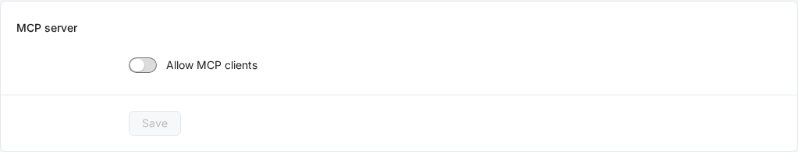

# MCP

The console serves MCP (Streamable HTTP) at `<console URL>/mcp`: AI clients call console procedures after you authorize them over OAuth. Off by default.

## Switch it on

1. The console URL (`EDGEWEIR_PUBLIC_URL`) must be HTTPS and reachable by the client; cloud clients such as Claude.ai need it on the public internet.
2. Open **System** → **General** → **MCP server**, switch on **Allow MCP clients** and **Save**.
3. Copy the **Server URL** into the client.

Off: `/mcp`, the OAuth endpoints and their metadata answer 404. Grants stay and work again once it is back on.

## Add it to a client

| Client | Steps |
| --- | --- |
| Claude Code | `claude mcp add --transport http edgeweir https://console.example.com/mcp`, then run `/mcp` in Claude Code and pick `edgeweir` to sign in |
| Claude.ai | **Settings** → **Connectors** → **Add custom connector**, enter the server URL, then **Connect** |
| Cursor | Put `{"mcpServers": {"edgeweir": {"url": "https://console.example.com/mcp"}}}` in `~/.cursor/mcp.json` and sign in from the MCP settings |
| Codex | `codex mcp add edgeweir --url https://console.example.com/mcp`, then `codex mcp login edgeweir` |

The client opens a browser: sign in to the console if needed (the login allow list and two-factor authentication apply), pick **Read only** or **Read and write** on the consent page and **Allow**.

## Consent page

| Item | Meaning |
| --- | --- |
| Client | Host of the client's metadata document (a URL client_id), or **Registered client** (dynamic registration) |
| Returns to | Host the authorization code goes to. On this computer (`localhost`, `127.0.0.1`, `[::1]`) a note asks you to allow only a client you just started |
| Access | **Read only** by default; **Read and write** grants changes. The demo account grants read access only |

## Scopes

| Scope | Allows |
| --- | --- |
| `edgeweir:read` | `GET` procedures and the procedures read-only AccessKeys may call (e.g. `rules.validate`) |
| `edgeweir:write` | Every available procedure, changes included |
| `offline_access` | A refresh token: the client renews access without asking again |

A change without `edgeweir:write` gets 403 `insufficient_scope` from `/mcp`, so the client can ask for it.

MCP clients cannot call AccessKeys, service accounts, extension publisher keys, MCP settings, the login allow list, the demo account, setup, or procedures that return a credential once (`MCP_PROCEDURE_FORBIDDEN`).

## Tools

| Tool | Does |
| --- | --- |
| `search_operations` | Finds procedures by keyword or group; without arguments lists the groups |
| `describe_operation` | JSON Schema of a procedure's input and output |
| `call_operation` | Calls a procedure |
| `get_overview` | Overview |
| `list_sites` | Sites |
| `purge_cache` | Purges cache |
| `query_access_logs` | Access logs (`from` and `to` required) |
| `get_site_stats` | Traffic statistics |
| `list_alerts` | Alert events |

Tool calls run the procedure inside the console: validation, optimistic concurrency and the audit log work as on the API. The audit log names the actor **MCP client** and its name. A result over 50,000 characters is cut; narrow the query or page.

## Connected apps

**Security** → **Connected apps** lists authorized clients, their access and when they were last used. **Revoke** deletes the grant and every token; the client's next request gets 401.

## Limits

| Item | Value |
| --- | --- |
| Access tokens | Opaque (`ewo_` prefix), stored as SHA-256 only, valid on `/mcp` only; `/mcp` ignores cookies and `x-api-key` |
| Rate | 600 requests a minute per grant; beyond that 429 with `Retry-After` |
| Dynamic registration | `/api/auth/oauth2/register` 10 a minute per IP; clients nobody authorized within 30 days are pruned hourly |
| Client metadata documents | Fetched through the console's outbound guard (no private addresses, no redirects), at most 5 KiB |
| PKCE | `S256` required |
| DPoP | Not supported; DPoP-bound tokens are refused |

## Discovery

| Path | Content |
| --- | --- |
| `/.well-known/oauth-protected-resource/mcp` | Protected resource metadata (RFC 9728) |
| `/.well-known/oauth-authorization-server/api/auth` | Authorization server metadata (RFC 8414); issuer `<console URL>/api/auth` |

A `/mcp` request without a token gets 401 with `resource_metadata` in `WWW-Authenticate` pointing at the protected resource metadata.
